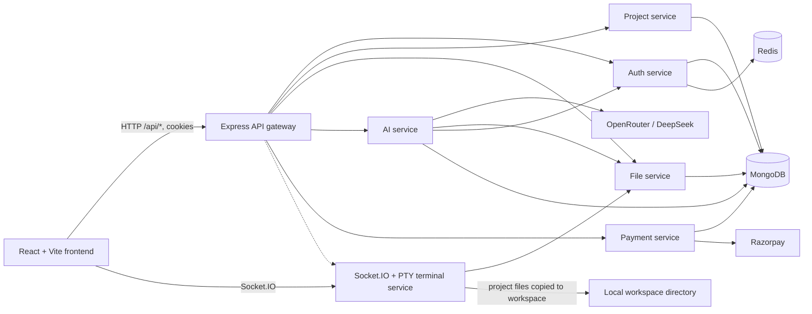

# DeepAI

DeepAI is an AI-assisted, browser-based coding workspace. It brings project organization, a code editor, an AI coding agent, a live preview, and a terminal into one application. It is an independent project with its own architecture and product scope—not a clone of Cursor or another editor.

This repository contains a React frontend and a set of Node.js backend services. The README describes the implementation currently present in the codebase; it does not imply feature parity with desktop IDEs or hosted development platforms.

## What you can do

- **Create and manage projects** — create workspaces, browse a project list, star projects, and delete them.
- **Edit project files in the browser** — navigate a nested file tree, open multiple tabs, edit code with Monaco, and save changes explicitly with the Save button or `Ctrl+S` / `Cmd+S`.
- **Ask the AI to work on a project** — send a prompt with recent conversation context. The agent can inspect the project tree and create folders, create files, and update existing files through project-aware tools.
- **See AI responses as they arrive** — AI chat responses use Server-Sent Events (SSE), with Markdown rendering and syntax-highlighted code blocks in the chat UI.
- **Preview web projects** — switch to a sandboxed iframe preview that combines an `index.html` file with project CSS and JavaScript files.
- **Use an integrated terminal** — the terminal UI uses xterm.js and connects to a backend Socket.IO service that launches a real pseudo-terminal (PTY) in a project workspace.
- **Sign in with Google** — Firebase Authentication handles the Google sign-in flow; the backend verifies the Firebase ID token and maintains an HTTP-only session cookie backed by Redis.
- **Manage AI credits** — user records have a credit balance, AI requests debit credits, and the payment service supports Pro and Team credit packages through Razorpay.
- **Work on mobile-sized screens** — the project workspace includes responsive pane switching for the explorer, editor, and AI chat.
- **Choose a dashboard theme** — the dashboard offers light/dark theme selection and remembers the preference in local storage.

## Current implementation notes

These details are useful when evaluating or extending the project:

- The AI provider is configured in `backend/services/ai/config/llm.js` to use `deepseek/deepseek-chat` through LangChain's OpenRouter integration.
- AI file operations are scoped to the current project and user via the file service. The available tools are `get_tree`, `get_file`, `create_folder`, `create_file`, and `update_file`.
- The AI stream endpoint currently charges **10 credits per request**. The plans UI and the credit debit implementation are separate code paths; verify displayed plan copy and credit behavior before changing pricing.
- The preview currently constructs a document from `index.html`, `.css`, and `.js` file contents. It is not a general-purpose dev server or full build pipeline for arbitrary frameworks.
- The terminal service copies the persisted project tree into a local workspace directory when a terminal session starts, then launches the configured shell there. Do not assume terminal-side edits are automatically written back to the database.
- The UI displays Free, Pro, and Team plan descriptions. The existence of plan copy is not evidence that every advertised capability (for example, team collaboration) is implemented.
- No automated test script is defined in the frontend or service package manifests at the time of writing.

## Feature and engineering accomplishments

- Delivered a complete browser workspace flow spanning sign-in, project selection, file editing, AI assistance, preview, and terminal access.
- Split backend responsibilities into separate gateway, authentication, project, file, AI, payment, and terminal services.
- Built an agent workflow that can inspect a project's structure and use validated, project-scoped file tools instead of returning code snippets only.
- Implemented incremental AI delivery over SSE and incremental terminal input/output over Socket.IO.
- Modeled users, projects, files, and payments in MongoDB, and used Redis for session storage.
- Added a Razorpay order-and-verification flow that verifies payment signatures before adding purchased credits.
- Included responsive workspace navigation and keyboard-based file saving alongside the core editor experience.

These are implementation milestones, not user-count, performance, reliability, or production-readiness claims.

## Architecture



### Frontend

The frontend is a React 19 single-page application built with Vite. Its primary routes are:

| Route | Purpose |
| --- | --- |
| `/` | Dashboard, sign-in, and project management |
| `/project/:id` | Project explorer, Monaco editor, AI chat, preview, and bottom panel |
| `/plans` | Credit plans and payment checkout |

`src/pages` contains the main screens. Reusable UI is in `src/components`; API calls are grouped in `src/features`; Redux Toolkit stores user and project state in `src/redux`. Axios is configured to send credentials to the API gateway. AI chat uses `fetch` to consume its SSE response, while the terminal uses Socket.IO.

Key frontend technologies include React, React Router, Redux Toolkit, Monaco Editor, xterm.js, Socket.IO Client, Tailwind CSS, Motion, Firebase Client SDK, and Axios.

### API gateway and backend services

The Express gateway is the browser-facing API entry point. It routes `/api/auth`, `/api/project`, `/api/file`, `/api/terminal`, `/api/ai`, and `/api/payment` to service URLs from its environment. Protected routes validate the Redis-backed session cookie and pass the authenticated user ID to downstream services in the `x-user-id` header.

| Service | Responsibility |
| --- | --- |
| `backend/gateway` | CORS, request logging, session protection, and HTTP proxy routing |
| `backend/services/auth` | Firebase ID-token verification, user records, login/logout sessions, and credit balances |
| `backend/services/project` | Project creation, listing, lookup, starring, and deletion |
| `backend/services/file` | Project roots, nested file/folder records, tree generation, file reads, updates, and deletion |
| `backend/services/ai` | LangGraph-based coding workflow, streaming chat endpoint, file tools, and AI credit deduction |
| `backend/services/payment` | Razorpay order creation, signature verification, payment records, and credit top-ups |
| `backend/services/terminal` | Socket.IO terminal events, project workspace materialization, and PTY lifecycle |

Each service is an independently started Node.js application. MongoDB-backed services connect using `MONGODB_URI`. The Redis client reads `REDIS_URL`.

### AI request lifecycle

1. The frontend submits a project ID, user message, recent chat history, and optional terminal socket ID to `POST /api/ai/chat/stream`.
2. The gateway checks the session and forwards the authenticated user ID.
3. The AI controller validates the request and deducts its configured credit amount before opening the stream.
4. The LangGraph workflow invokes the configured chat model and, when needed, project file tools.
5. The file tools call the file service with the user's ID to inspect or modify the correct project's tree and files.
6. The AI service streams events back to the browser as SSE; the chat UI renders the response and tool activity.

The prompt history is limited to recent user/assistant messages in the AI controller to reduce request size.

### Data and persistence

- **MongoDB** stores user, project, file/folder, and payment documents.
- **Redis** stores session records with an expiration; the current login flow sets a seven-day lifetime.
- **Project files** are stored as MongoDB file documents, with `parentId` relationships used to construct nested trees.
- **Terminal workspace** is materialized to local disk from the file service when a terminal starts. The terminal service also uses the configured local shell and workspace root.

## HTTP API overview

The gateway prefixes downstream service routes with `/api`. Protected routes require a valid session cookie.

| Method | Path | Purpose |
| --- | --- | --- |
| `POST` | `/api/auth/login` | Verify a Firebase ID token and establish a session |
| `GET` | `/api/auth/logout` | Clear the current session |
| `GET` | `/api/me` | Return the authenticated session user |
| `POST` | `/api/project` | Create a project |
| `GET` | `/api/project` | List the user's projects |
| `GET` | `/api/project/starred` | List starred projects |
| `GET` | `/api/project/:id` | Fetch a project |
| `PATCH` | `/api/project/:id/star` | Toggle a project's starred state |
| `DELETE` | `/api/project/:id` | Delete a project |
| `POST` | `/api/file/root` | Create a project's root folder |
| `GET` | `/api/file/tree/:projectId` | Fetch a project file tree |
| `GET` | `/api/file/:id` | Fetch a file |
| `POST` | `/api/file/folder` | Create a folder |
| `POST` | `/api/file/file` | Create a file |
| `PUT` | `/api/file/:id` | Update a file |
| `DELETE` | `/api/file/:id` | Delete a file |
| `POST` | `/api/ai/chat/stream` | Start an SSE AI coding conversation |
| `POST` | `/api/payment/create-order` | Create a Razorpay order for a supported plan |
| `POST` | `/api/payment/verify` | Verify payment and grant credits |

The terminal uses a separate Socket.IO connection rather than these HTTP routes. Its current event protocol includes `terminal:init`, `terminal:data`, and `terminal:resize`.

## Technology stack

| Area | Technologies |
| --- | --- |
| Frontend | React, Vite, React Router, Redux Toolkit, Tailwind CSS |
| Editor and terminal UI | Monaco Editor, xterm.js, xterm-addon-fit |
| UI and rendering | Motion, Lucide/React Icons, React Markdown, Prism syntax highlighting |
| Backend | Node.js, Express |
| AI orchestration | LangChain, LangGraph, Zod, OpenRouter chat model |
| Persistence and sessions | MongoDB/Mongoose, Redis/ioredis |
| Authentication | Firebase Authentication and Firebase Admin |
| Payments | Razorpay |
| Terminal transport | Socket.IO, node-pty |

## Getting started

### Prerequisites

- Node.js and npm versions compatible with the dependencies in the package manifests.
- MongoDB, with a connection URI accessible to the backend services.
- Redis, with a connection URI accessible to the backend.
- A Firebase project configured for Google sign-in and a Firebase Admin service account.
- An OpenRouter API key for AI requests.
- Razorpay API credentials to exercise paid plans.
- A platform with the native build prerequisites required by `node-pty` for the integrated terminal.

### Configure environment

The services use `dotenv` and expect configuration in each process's environment (commonly via a service-local `.env` file in the directory from which that service is launched). The frontend reads Vite variables at build/dev-server startup. Set values for the services you intend to run:

| Variable | Used by | Description |
| --- | --- | --- |
| `VITE_SERVER_URL` | Frontend | Base URL of the HTTP API gateway |
| `VITE_TERMINAL_URL` | Frontend | Socket.IO URL of the terminal service |
| `PORT` | Gateway and backend services | Listening port for that process |
| `FRONTEND_URL` | Gateway | Allowed browser origin for credentialed CORS |
| `AUTH_SERVICE` | Gateway | Auth service base URL |
| `PROJECT_SERVICE` | Gateway | Project service base URL |
| `FILE_SERVICE` | Gateway | File service base URL |
| `TERMINAL_SERVICE` | Gateway | Terminal service base URL |
| `AI_SERVICE` | Gateway | AI service base URL |
| `PAYMENT_SERVICE` | Gateway | Payment service base URL |
| `MONGODB_URI` | Mongo-backed services | MongoDB connection string |
| `REDIS_URL` | Auth/shared Redis client | Redis connection string |
| `OPENROUTER_API_KEY` | AI service | OpenRouter credential for the configured model |
| `FILE_SERVICE_URL` | AI and terminal services | Internal file service base URL |
| `AUTH_SERVICE_URL` | AI service | Internal auth service base URL used for credit deduction |
| `RAZORPAY_KEY_ID` | Payment service | Razorpay public key ID |
| `RAZORPAY_KEY_SECRET` | Payment service | Razorpay secret used for order/payment operations |
| `WORKSPACE_ROOT` | Terminal service | Local directory for materialized project workspaces |
| `SHELL` | Terminal service | Optional shell executable; defaults to PowerShell on Windows and Bash elsewhere |

Firebase Admin currently imports the service-account JSON from `backend/services/auth/serviceAccountKey.json`. Supply your own valid credential file at the expected location, keep it private, and never commit real credentials. Do not copy secrets into this README.

### Install dependencies

There is no root-level orchestration script. Install the frontend and each backend package separately:

```powershell
cd frontend
npm install

cd ..\backend
npm install

cd gateway
npm install

cd ..\services\auth
npm install

cd ..\ai
npm install

cd ..\file
npm install

cd ..\project
npm install

cd ..\payment
npm install

cd ..\terminal
npm install
```

### Start local dependencies and applications

Start Redis using the repository's Compose file:

```powershell
docker compose -f backend\docker-compose.yml up -d redis
```

Start MongoDB separately (the Compose file only defines Redis), then start each application in its own terminal after setting its environment:

```powershell
# Frontend
cd frontend
npm run dev
```

```powershell
# Gateway
cd backend\gateway
npm run dev
```

Run the same `npm run dev` command from each of these service directories in separate terminals:

```text
backend\services\auth
backend\services\project
backend\services\file
backend\services\ai
backend\services\payment
backend\services\terminal
```

Ensure the gateway's service URLs point at the matching service ports, and ensure the frontend's HTTP and terminal URLs point at the gateway and Socket.IO service respectively. Ports are configured per process; there is no checked-in root-level development orchestrator.

## Development commands

From `frontend`:

```powershell
npm run dev
npm run build
npm run lint
npm run preview
```

Each backend package defines `npm run dev` for its service entry point. There are no test scripts in the checked-in package manifests.

## Security and deployment considerations

- Keep Firebase service-account data, MongoDB and Redis credentials, model API keys, and Razorpay secrets outside version control.
- The terminal service runs a real shell in a local workspace. Only expose it to trusted users and networks, and review its authentication/origin configuration before deployment.
- Use HTTPS for deployed frontend/API traffic and configure the gateway's credentialed CORS origin to the exact frontend origin.
- Configure and verify session-cookie settings for the intended deployment environment.
- Review authorization and ownership checks across every service before hosting user projects or allowing AI-generated file changes.
- Add production-grade observability, rate limits, tests, backup strategy, and deployment orchestration before treating the project as a production service.

## Repository map

```text
.
├── backend/
│   ├── gateway/                 # HTTP API gateway and session middleware
│   ├── services/
│   │   ├── ai/                  # AI controller, graph, model config, and file tools
│   │   ├── auth/                # Firebase auth, user model, and Redis sessions
│   │   ├── file/                # File/folder model, routes, controllers, and tree
│   │   ├── payment/             # Razorpay orders, verification, and credit updates
│   │   ├── project/             # Project model and project routes
│   │   └── terminal/            # Socket.IO terminal and PTY workspaces
│   ├── shared/redis/            # Shared Redis client
│   └── docker-compose.yml       # Local Redis dependency
└── frontend/
    └── src/
        ├── components/          # Editor, explorer, AI chat, preview, terminal, UI
        ├── features/             # API request helpers
        ├── pages/                # Dashboard and project workspace pages
        ├── redux/                # User and project state
        └── utils/                # API, Firebase, and file icon helpers
```

## License

No license file is included in this repository. Add a license before redistributing the project if you intend to grant permissions to others.
